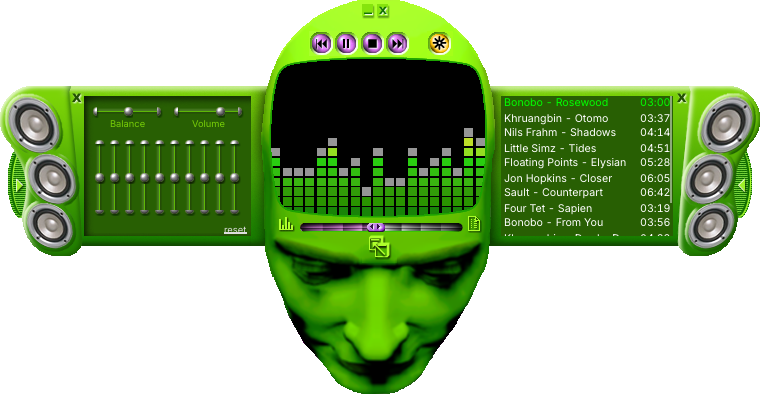
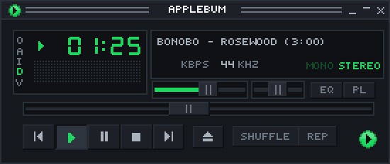

# Applebum

A fast, native Apple Music client for macOS with a Winamp face, MilkDrop
visualizers, and AirPlay for this app alone.



*Above: the classic Windows Media Player skin Headspace, which isn't included;
see [Skins](#skins). Below: the player as it comes.*



It's a personal project built on [Spotifast](https://github.com/crmne/spotifast)
by Carmine Paolino, which does the hard part: the interface, skins and
visualizers. Applebum replaces Spotify with Apple Music through Apple's own
MusicKit, so you need an **Apple Music subscription**. It decrypts nothing:
Apple's player plays the music.

## What it does

- **Opens quickly.** About 0.5 s to a window, against about 1.3 s for Music.app,
  measured on one M1 Pro.
- **Wears classic skins.** Winamp 2 (`.wsz`) and Windows Media Player (`.wmz`).
- **Plays on a HomePod by itself.** Send only Applebum to a HomePod while your
  Mac keeps its other sound. Choose it in Playback > Output.
- **Has a volume and an equalizer,** which Apple's player doesn't offer apps.
- **Uses your library,** including songs you uploaded. It doesn't need Music.app
  open.
- **MilkDrop** through [projectM](https://github.com/projectM-visualizer/projectm),
  driven by the music playing.

## Build it

You need macOS 15 or later on Apple Silicon, Xcode, [Rust](https://rustup.rs),
CMake (`brew install cmake`), and a paid
[Apple Developer](https://developer.apple.com/programs/) membership, because
MusicKit only works from a signed app whose App ID has it enabled.

1. Create an App ID at
   https://developer.apple.com/account/resources/identifiers/add/bundleId with
   your own bundle ID, and tick **MusicKit** under **App Services**. It can take
   about 20 minutes to start working; until then you'll see
   `developerTokenRequestFailed` or HTTP 401.
2. Put it in `.applebum.env`, which git ignores:
   ```sh
   echo 'BUNDLE_ID=com.example.applebum' > .applebum.env
   ```
3. Build, sign and open it:
   ```sh
   scripts/run-apple.sh
   ```
   The first build also downloads Mbed TLS. The app lands in
   `target/release/Applebum.app`; copy it to `/Applications` to keep it.

macOS asks for Apple Music, audio capture and local network access the first
time. Audio capture is how volume, the equalizer, visualizers and AirPlay get
the sound. It stays in memory and is never recorded.

## Skins

Drop any `.wsz` or `.wmz` on the window to install and wear it. Find them at the
[Winamp Skin Museum](https://skins.webamp.org) and the Internet Archive's
[Windows Media Player Skins Collection](https://archive.org/details/windowsmediaplayerskinscollection).

For the green alien head, **Headspace**, quit Applebum and run:

```sh
scripts/install-headspace.sh
```

It downloads the skin from the Internet Archive, checks it, and turns it on.
The skin isn't in this repository: it's a classic Windows Media Player skin with
no published license, so it's fetched on your own machine for your own use.

## Handy things

- **Player size:** View > Player Size, or Cmd+Option+= and Cmd+Option+-.
- **Main window:** Cmd+Shift+M switches between it and the skin.
- **A playlist waiting at launch:** with Applebum quit, add
  `"startup_playlist": "Playlist name"` to
  `~/Library/Application Support/xyz.vladik.applebum/settings.json`.
- **Command line:** `Applebum.app/Contents/MacOS/Applebum play-search bonobo kiara`.
  `--help` lists the rest.

## Known limits

- Home's personal shelves are empty. Queue and library are the way around for now.
- The first song after launch takes about 2-3 s, which Apple's player decides.
- Only HomePods are offered for AirPlay. Apple TVs need a PIN, which isn't built.
- AirPlay buffers, so visuals can run ahead of a HomePod's sound and pause can lag.
- Apple offers no way to remove a song from your library, so taking back a heart
  clears the rating and leaves the song there.
- Lossless playback is unconfirmed: MusicKit doesn't report what it's playing.
- Spotify code from upstream is still in the tree, unused. Only macOS is supported.
- Skins run their own scripts inside the app's interpreter, as they always did.
  Install ones you trust.

## Credits and license

MIT, see [LICENSE](LICENSE). Built on Spotifast (MIT) by Carmine Paolino.
AirPlay comes from [airplay2-sender-cpp](https://github.com/akustikrausch/airplay2-sender-cpp)
(Apache-2.0), vendored in `third_party/` with its notices.

Applebum is an independent project, not affiliated with or endorsed by Apple,
Spotify, Microsoft or Winamp. Apple Music and HomePod are trademarks of Apple Inc.
